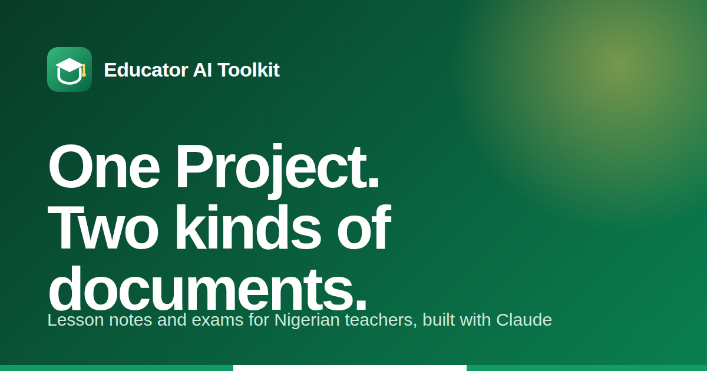

<div align="center">

# Educator AI Toolkit

**One Claude Project. Two kinds of documents.** Set it up once, then ask for a lesson note or an exam in plain words.

[](https://github.com/babatundeawo/educator-ai-toolkit/actions/workflows/deploy.yml)
[](https://github.com/babatundeawo/educator-ai-toolkit/actions/workflows/codeql.yml)

[Live site](https://babatundeawo.github.io/educator-ai-toolkit/) · [Setup guide](https://babatundeawo.github.io/educator-ai-toolkit/setup.html) · [Report an issue](https://github.com/babatundeawo/educator-ai-toolkit/issues)

</div>



## About

Educator AI Toolkit is a free, mobile-first guide for Nigerian teachers who use [Claude](https://claude.ai). It walks you through creating a single Claude Project loaded with your school's details and the official Scheme of Work. After that one-time setup, you ask for what you need and receive a formatted Word document.

It is built by Babatunde Awoyemi for Techbase Consultant Services.

## Features

- **Weekly lesson notes.** Say a Week number and get a complete lesson note booklet with dates worked out for you.
- **Exams, marking guides and revision files.** Say a Term and get a 70-mark exam with marking guide, or a self-study revision file.
- **Guided setup.** A five-step wizard with a live editor that fills your school's name, address, state and location into the Master Instructions.
- **Scheme of Work picker.** Choose a class and subject, then download only the files you need (117 files covering JSS1 to SS3).
- **Search and dark mode.** Press `Ctrl K` (or `/`) to search; light and dark themes follow your device and are remembered.
- **Works on a phone.** Layouts, touch targets and downloads are designed for small screens first.

## How to use it

1. Open the [setup guide](https://babatundeawo.github.io/educator-ai-toolkit/setup.html) and follow the five steps.
2. Ask for a [lesson note](https://babatundeawo.github.io/educator-ai-toolkit/lesson-note-generator.html) or an [exam, marking guide or revision file](https://babatundeawo.github.io/educator-ai-toolkit/exam-generator.html).
3. Find links, downloads and e-note sources on the [resources page](https://babatundeawo.github.io/educator-ai-toolkit/resources.html), and answers on the [FAQ](https://babatundeawo.github.io/educator-ai-toolkit/faq.html).

## Tech stack

- Static HTML, CSS and vanilla JavaScript, with no framework and no build step
- [JSZip](https://stuk.github.io/jszip/) (loaded only when several scheme files are downloaded together)
- Fonts: Bricolage Grotesque, Inter and JetBrains Mono via Google Fonts
- Hosted on GitHub Pages, deployed by GitHub Actions

## Project structure

```
index.html, setup.html, ...   The site's pages
404.html                      Not-found page
assets/                       Stylesheet, scripts, icons and social image
files/                        Reference files and the Scheme of Work (files/scheme/)
docs/                         Guides for maintaining the site
scripts/                      Automated checks run by GitHub Actions
.github/                      Workflows, Dependabot and issue templates
```

## Contributing

Found a mistake or have an idea? [Open an issue](https://github.com/babatundeawo/educator-ai-toolkit/issues/new/choose) or send a pull request from the GitHub website. See [CONTRIBUTING.md](CONTRIBUTING.md).

## Security

Please report vulnerabilities privately. See [SECURITY.md](SECURITY.md).

## Credits

Fonts are used under the SIL Open Font License through Google Fonts. Claude is made by Anthropic.
